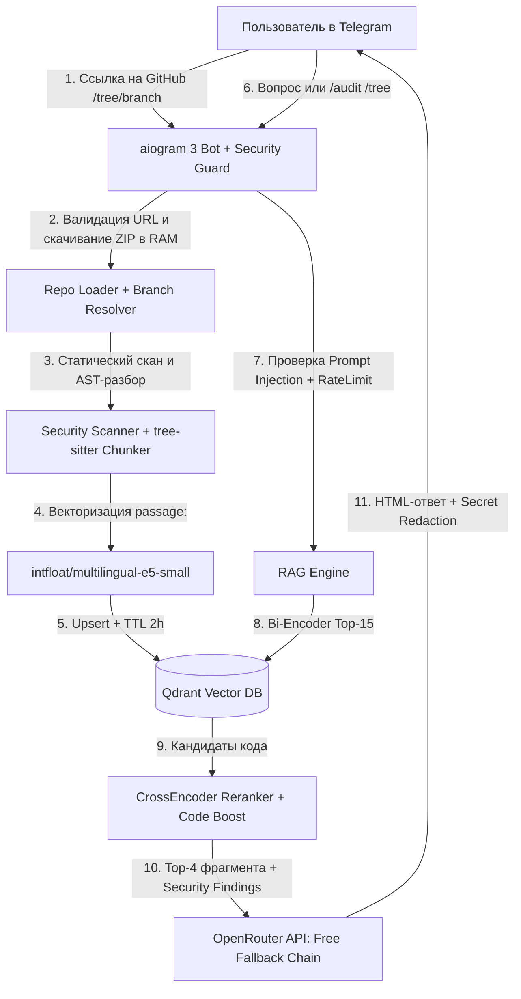

# Repo Navigator Bot (`v0.2.0`)

Telegram-бот для семантического поиска, Q&A и базового аудита безопасности по кодовой базе публичных GitHub-репозиториев на базе **Codebase RAG** (AST-чанкинг, векторный поиск, нейросетевой реранкинг, статический сканер рисков и ответы LLM со ссылками на конкретные файлы и строки кода).

## Архитектура (Codebase RAG & Security Pipeline)



## Ключевые особенности (`v0.2.0`)

- **Поддержка веток GitHub (`/tree/<branch>`):** можно анализировать как дефолтные ветки (`main`/`master`), так и конкретные feature-ветки с точными ссылками на строки кода (`blob/<branch>/path#Lstart-Lend`).
- **AST-чанкинг исходного кода (`tree-sitter`):** разбивает код на логические единицы (функции, классы, методы, структуры) для Python, JS/TS, Go, Rust, Java, C/C++, C#, PHP, Ruby, сохраняя точные номера строк (`start_line`–`end_line`). Для Markdown, YAML и конфигов используется построчный чанкинг с перекрытием.
- **Базовый AppSec-аудит (`/audit`) и навигация по структуре (`/tree`):**
  - Статический сканер проверяет код на опасные конструкции (`eval`/`exec`, `pickle.loads`, `yaml.load`, `os.system`, `shell=True`, потенциальный XSS/SQLi, `verify=False`) и возможные утечки статических ключей.
  - Гибридный LLM-отчёт объединяет находки статического анализатора с семантически найденными модулями аутентификации и работы с секретами.
- **Двухэтапный поиск (Retrieve & Rerank):**
  1. Быстрый векторный поиск топ-15 кандидатов в **Qdrant** с помощью мультиязычной модели эмбеддингов `intfloat/multilingual-e5-small`.
  2. Точная пересортировка через `DiTy/cross-encoder-russian-msmarco` с приоритетом исходного кода над документацией (`.md`) и отбором топ-4 фрагментов.
- **Безопасность и управление памятью:**
  - Валидация GitHub URL (защита от SSRF), фильтрация бинарных и служебных директорий (`node_modules`, `.git`, `.min.js`).
  - Санитизация Indirect Prompt Injections в чужом коде, фильтрация инъекций в вопросах пользователя и маскирование секретов (`redact_secrets`) в ответах бота.
  - Автоматическая очистка проиндексированных репозиториев и кэша метаданных по истечении **2 часов** (`INDEX_TTL_SECONDS=7200`).

## Команды бота

- Отправка ссылки на GitHub (например, `https://github.com/bad-cyber/repo-navigator-bot` без пробелов) — загрузка и индексация репозитория или выбранной ветки.
- Любой текстовый вопрос — поиск по кодовой базе с кликабельными ссылками на строки кода.
- `/tree` — вывод дерева проиндексированных файлов активного репозитория.
- `/audit` — статический и RAG-аудит безопасности репозитория.
- `/status` — отображение текущего репозитория и активной ветки.
- `/help` — справка по командам.

## Технологический стек

- **Backend & Bot:** Python 3.11+, `aiogram 3.x`, `pydantic-settings`, `httpx`
- **Code Parsing:** `tree-sitter-language-pack`
- **ML / Embeddings / Reranker:** `sentence-transformers` (`intfloat/multilingual-e5-small`, `DiTy/cross-encoder-russian-msmarco`)
- **Vector Database:** `Qdrant` (Docker)
- **LLM Provider:** OpenRouter API (`openai` Python SDK) с цепочкой fallback-моделей
- **Testing & CI:** `pytest`, `pytest-asyncio`, GitHub Actions

## Быстрый старт (локально)

1. **Клонируйте репозиторий и создайте виртуальное окружение:**
   ```bash
   git clone https://github.com/bad-cyber/repo-navigator-bot.git
   cd repo-navigator-bot
   python -m venv .venv
   source .venv/bin/activate  # для Windows: .venv\Scripts\activate
   ```
   *(Уберите пробелы вокруг слэшей в URL при копировании команды).*

2. **Установите зависимости:**
   ```bash
   pip install torch --index-url https://download.pytorch.org/whl/cpu
   pip install -r requirements.txt
   ```

3. **Запустите Qdrant в Docker:**
   ```bash
   docker-compose up -d
   ```

4. **Настройте переменные окружения:**
   ```bash
   cp .env.example .env
   ```
   Укажите в `.env` ваш `BOT_TOKEN` (от `@BotFather`) и `LLM_API_KEY` (бесплатный ключ OpenRouter).

5. **Запустите бота и тесты:**
   ```bash
   python -m src.main
   pytest -v
   ```

## Автор и лицензия

- **Автор:** Никита Емельянов ([bad-cyber](https://github.com/bad-cyber))
- **Лицензия:** [MIT](LICENSE)

---
*Примечание: при проектировании архитектуры, написании модульных тестов и оформлении документации использовались ИИ-ассистенты.*
