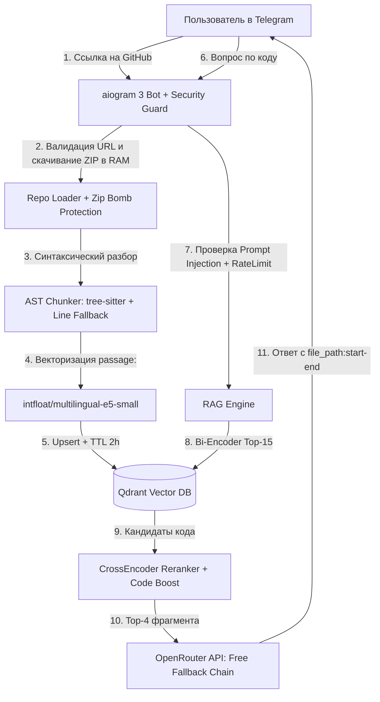

# Repo Navigator Bot (`v0.1.0`)

Telegram-бот для семантического поиска и Q&A по кодовой базе публичных GitHub-репозиториев на базе **Codebase RAG** (AST-чанкинг, векторный поиск, нейросетевой реранкинг и ответы LLM со ссылками на конкретные файлы и строки кода).

## Архитектура (Codebase RAG Pipeline)



## Ключевые особенности

- **AST-чанкинг исходного кода (`tree-sitter`):** разбивает код на логические единицы (функции, классы, методы, структуры) для Python, JS/TS, Go, Rust, Java, C/C++, C#, PHP, Ruby, сохраняя точные номера строк (`start_line`–`end_line`). Для Markdown, YAML и конфигов используется построчный чанкинг с перекрытием.
- **Двухэтапный поиск (Retrieve & Rerank):**
  1. Быстрый векторный поиск топ-15 кандидатов в **Qdrant** с помощью мультиязычной модели эмбеддингов `intfloat/multilingual-e5-small`.
  2. Точная пересортировка через `DiTy/cross-encoder-russian-msmarco` с приоритетом исходного кода над документацией (`.md`) и отбором топ-4 фрагментов.
- **Бесплатный облачный LLM-слой с отказоустойчивостью:** работа через OpenRouter API с автоматическим переключением по цепочке бесплатных моделей при перегрузках (`429`) и резервной выдачей найденных участков кода.
- **Безопасность и управление памятью:**
  - Валидация GitHub URL (защита от SSRF), фильтрация бинарных и служебных директорий (`node_modules`, `.git`, `.min.js`).
  - Санитизация Indirect Prompt Injections внутри чужого исходного кода и защита от инъекций в вопросах пользователя.
  - Автоматическая очистка проиндексированных репозиториев из Qdrant по истечении **2 часов** (`INDEX_TTL_SECONDS=7200`).

## Технологический стек

- **Backend & Bot:** Python 3.11+, `aiogram 3.x`, `pydantic-settings`, `httpx`
- **Code Parsing:** `tree-sitter-language-pack`
- **ML / Embeddings / Reranker:** `sentence-transformers` (`intfloat/multilingual-e5-small`, `DiTy/cross-encoder-russian-msmarco`)
- **Vector Database:** `Qdrant` (Docker)
- **LLM Provider:** OpenRouter API (`openai` Python SDK)
- **Testing & CI:** `pytest`, `pytest-asyncio`, GitHub Actions

## Быстрый старт (локально)

1. **Клонируйте репозиторий и создайте виртуальное окружение:**
   ```bash
   git clone https: / / github.com / bad-cyber / repo-navigator-bot.git
   cd repo-navigator-bot
   python -m venv .venv
   source .venv/bin/activate  # для Windows: .venv\Scripts\activate
   ```
   *(Уберите пробелы вокруг слэшей в URL при копировании команды).*

2. **Установите зависимости:**
   ```bash
   pip install torch --index-url https: / / download.pytorch.org / whl / cpu
   pip install -r requirements.txt
   ```

3. **Запустите Qdrant в Docker:**
   ```bash
   docker-compose up -d
   ```

4. **Настройте переменные окружения:**
   ```bash
   cp .env.example .env
   ```
   Укажите в `.env` ваш `BOT_TOKEN` (от `@BotFather`) и `LLM_API_KEY` (бесплатный ключ OpenRouter).

5. **Запустите бота:**
   ```bash
   python -m src.main
   ```

## Запуск тестов

```bash
pytest -v
```

## Структура проекта

```text
repo-navigator-bot/
├── .github/workflows/ci.yml   # CI-пайплайн для автоматического прогона тестов
├── src/
│   ├── bot/handlers.py        # Хендлеры Telegram-бота и FSM
│   ├── services/
│   │   ├── chunker.py         # AST-парсер (tree-sitter) и построчный чанкер
│   │   ├── rag_engine.py      # Индексация в Qdrant, реранкинг, TTL и вызов LLM
│   │   ├── repo_loader.py     # Скачивание и фильтрация ZIP-архивов GitHub в RAM
│   │   └── security.py        # Защита от SSRF, Prompt Injection и RateLimiter
│   ├── config.py              # Конфигурация приложения (pydantic-settings)
│   └── main.py                # Точка входа и прогрев локальных ML-моделей
├── tests/                     # 50 модульных тестов (security, chunker, loader, rag)
├── docker-compose.yml         # Контейнер векторной БД Qdrant
├── Dockerfile                 # Сборка образа бота на CPU PyTorch
└── requirements.txt           # Зависимости Python
```

## Автор и лицензия

- **Автор:** Никита Емельянов ([bad-cyber](https://github.com/bad-cyber))
- **Лицензия:** [MIT](LICENSE)

---
*Примечание: при проектировании архитектуры, написании модульных тестов и оформлении документации использовались ИИ-ассистенты.*
